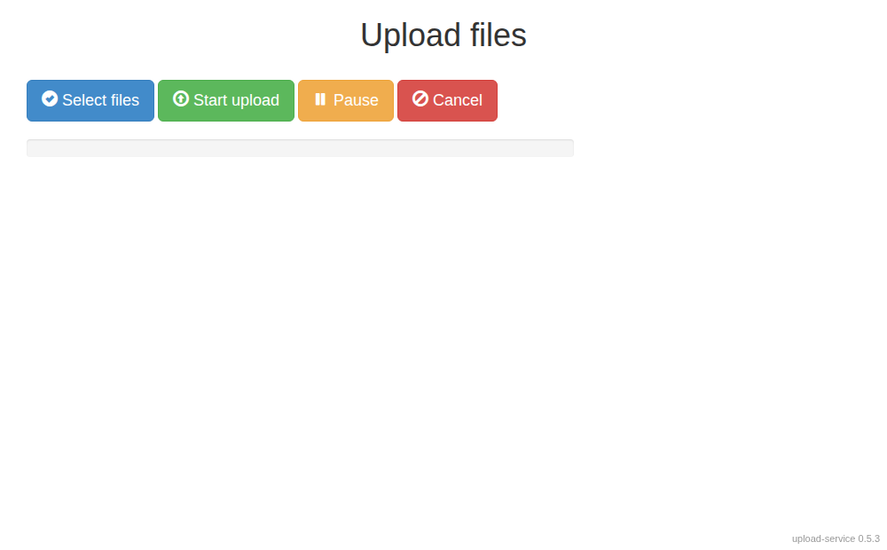

upload-service
==============

[](https://github.com/oposs/upload-service/actions/workflows/ci.yml)
[](https://github.com/oposs/upload-service/releases/latest)

A web application for uploading *large* files. The browser sends each file
in resumable chunks (https://github.com/23/resumable.js), and the backend,
written in Perl with https://mojolicious.org, stores it in an INBOX folder.



Install
-------

The packages install the service under `/opt/upload-service`, with the
Mojolicious it needs bundled. An example systemd unit and start script are in
`/usr/share/doc/upload-service/examples/`.

Debian and Ubuntu:

```sh
sudo install -d -m 0755 /etc/apt/keyrings
sudo curl -fsSL -o /etc/apt/keyrings/gitea-oposs.asc https://gitea.oetiker.ch/api/packages/oposs/debian/repository.key
echo "deb [signed-by=/etc/apt/keyrings/gitea-oposs.asc] https://gitea.oetiker.ch/api/packages/oposs/debian $(. /etc/os-release && echo $VERSION_CODENAME) main" | sudo tee /etc/apt/sources.list.d/oposs.list
sudo apt update && sudo apt install upload-service
```

AlmaLinux and Fedora (`el9`, `el10` or `fc45`, after the release of the
system):

```sh
sudo curl -fsSL -o /etc/yum.repos.d/oposs.repo https://gitea.oetiker.ch/api/packages/oposs/rpm/el10.repo
sudo dnf install upload-service
```

Alpine (`v3.23` or `v3.24`, after the release of the system):

```sh
cd /etc/apk/keys && sudo curl -fJO https://gitea.oetiker.ch/api/packages/oposs/alpine/key
echo "https://gitea.oetiker.ch/api/packages/oposs/alpine/v3.24/main" | sudo tee -a /etc/apk/repositories
sudo apk update && sudo apk add upload-service
```

From source: download the tarball from
https://github.com/oposs/upload-service/releases/latest, then

```sh
./configure --prefix=/opt/upload-service
make
make install
```

`make` downloads the current Mojolicious from CPAN into `thirdparty/`, so it
needs perl, curl or wget, unzip, and a C compiler for the indexing tools. From
a git checkout, run `./bootstrap` first.

Running
-------

`bin/us.pl` starts the Mojolicious application, for example

```sh
/opt/upload-service/bin/us.pl prefork --listen 'http://*:9873'
```

Put it behind a web server that terminates TLS, or let it listen on
`https://` itself; that needs IO::Socket::SSL from the distribution
(`libio-socket-ssl-perl`, `perl-IO-Socket-SSL`).

Configuration
-------------

The service is configured through environment variables.

`US_ROOT=/path` is where the uploaded files end up.

`US_SINGLEUSER=0|1` selects the mode. In single user mode the uploads go
straight to `$US_ROOT`, and the upload page is

    https://your-site/

In multi user mode the uploads go to `$US_ROOT/$USERNAME/INBOX`, and the
upload page is

    https://your-site/USERNAME/

In multi user mode the service runs as root, so that it can write as the
recipient of the files, and `MOJO_TMPDIR` must point to an empty directory
with mode 0777.

`US_NO_USERDB=0|1` lets multi user mode run when the recipients are not
known on the upload host, for example because the sandboxes come from a file
server mount. The service then needs no root rights: an upload for
`$USERNAME` is accepted when `$US_ROOT/$USERNAME/INBOX` is a directory (not a
symlink) that the service user can write to. The upload page shows the user
name instead of the full name.

`US_EMAILMODE=0|1` asks the sender for an email address and stores the
uploads in a subdirectory named after it.

`US_TAGMODE=0|1` hands out individual upload addresses:

    https://your-site/TAG

The tag is made of `[0-9a-z]+`, and the names of the uploaded files start
with it.

`US_SECRET_FILE=/path` names a file that holds the session secret. Without
it, Mojolicious signs the session cookie with the application name, which
anyone can guess. Create it once:

```sh
umask 077; head -c 48 /dev/urandom | base64 -w0 > /path/upload-service-secret
```
